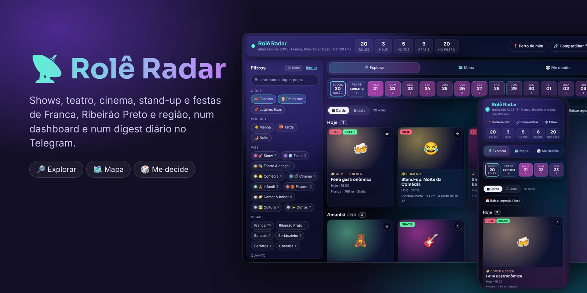
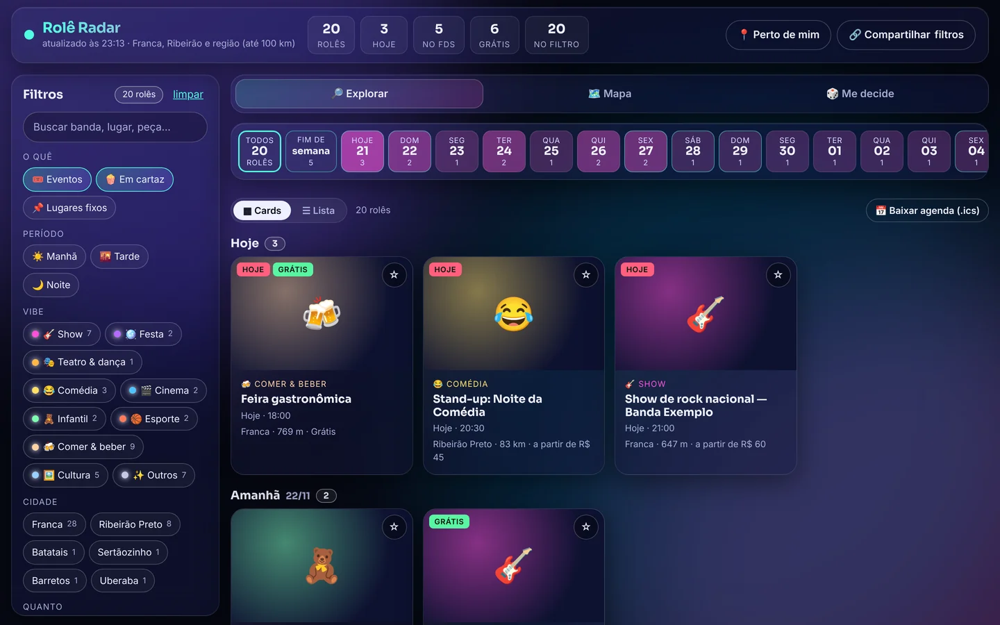
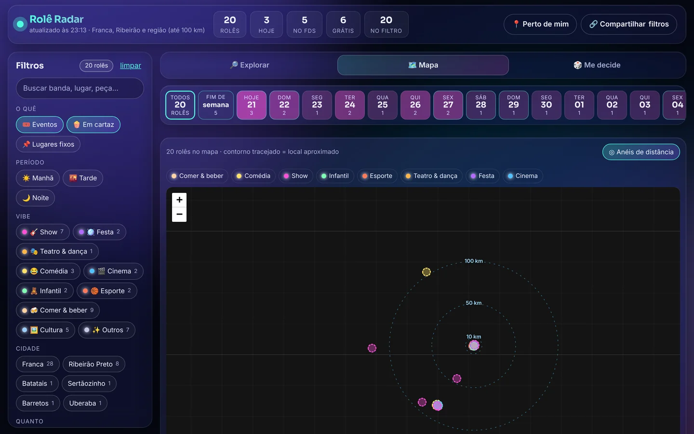
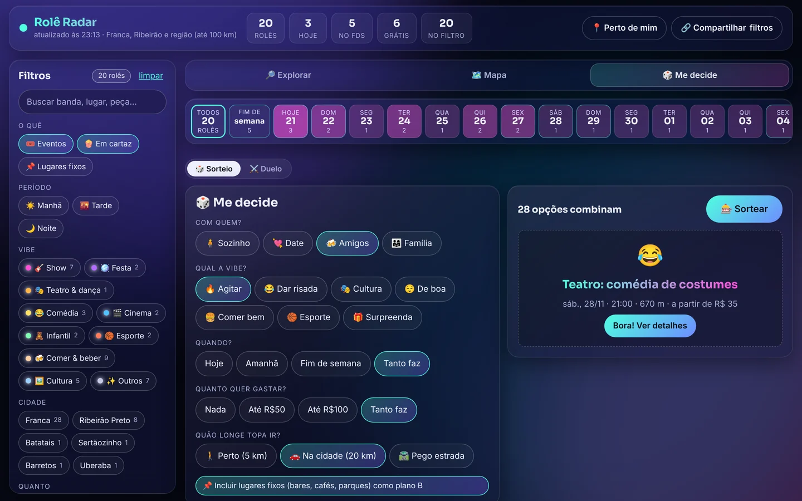
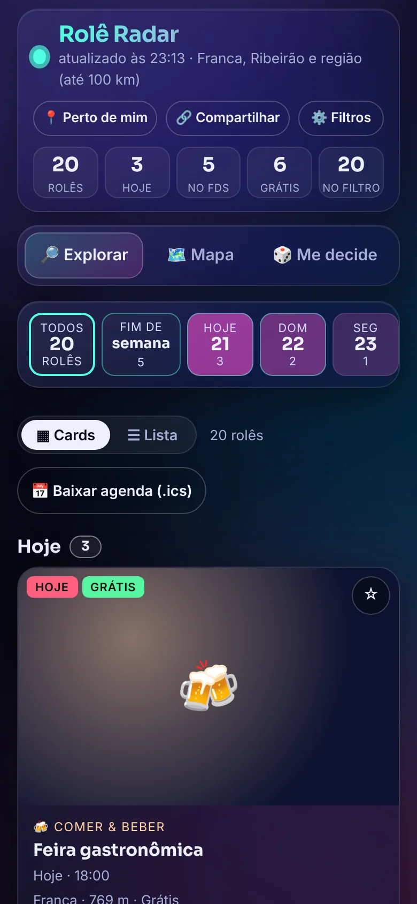

<p align="center">
  
</p>

<h1 align="center">📡 Rolê Radar</h1>

<p align="center">
  Shows, festivais, teatro, stand-up, cinema e atrações de <b>Franca-SP</b>, <b>Ribeirão Preto-SP</b> e região (até ~100 km),<br>
  com preço quando disponível. Dashboard web + digest diário no Telegram, tudo em pt-BR.
</p>

<p align="center">
  
  
  
</p>

---

## Como funciona

```
bilheterias + agendas + RSS ──► SQLite (dedupe) ──► curadoria com IA ──► Telegram
                                     │
                                     └──► dashboard web (Explorar · Mapa · Me decide)
```

1. **Coleta:** ~30 raspadores de bilheterias e agendas (`src/sources/`) e feeds RSS (Google News por query, Papelpop, perfis públicos).
2. **Dedupe:** tudo vai para o SQLite; título canônico + data identifica o evento, e temporadas/festivais viram um só.
3. **Curadoria:** um modelo compatível com a API da OpenAI filtra o que é rolê de verdade e extrai data, local e preço.
4. **Entrega:** digest diário no Telegram e dashboard web lendo o mesmo banco.

## Dashboard

`bun run serve` sobe um `Bun.serve` que lê o mesmo SQLite do job de coleta: o que o digest grava aparece no dash sem deploy novo.

### 🔎 Explorar

Faixa de 14 dias com "calor" por dia e lista agrupada por data, em cards com foto ou em linhas compactas.



### 🗺️ Mapa

Leaflet com tiles do OpenStreetMap em tema escuro, anéis de 10, 50 e 100 km e legenda por categoria. Local sem endereço geocodificado aparece no centro da cidade, com contorno tracejado.



> Neste print os tiles do mapa foram trocados por um fundo neutro, porque ele foi gerado offline.

### 🎲 Me decide

Dois modos: **Sorteio** (quiz de com quem, vibe, quando, orçamento e distância, que vira um ranking com % de match e uma roleta ponderada) e **Duelo** ("esse ou esse?" até sobrar um).



### 📱 No celular

<p align="center"></p>

**Também tem:** busca e filtros (tipo, quando, período, vibe, cidade, preço, distância, favoritos), tudo no hash da URL para compartilhar o link já filtrado; favoritos no `localStorage`; "Perto de mim"; e exportação da agenda em `.ics`.

**Rotas:** `/` (app), `/api/catalog` (JSON), `/agenda.ics` (Google, Apple ou Outlook), `/health`.

> Os prints usam dados de exemplo gerados localmente.

## Bot do Telegram

No modo `--loop` (`bun start`), o bot faz long polling para os chats de `TELEGRAM_CHAT_IDS`:

| Comando | O que faz |
|---|---|
| `/hoje` | eventos do dia, com os filtros do chat |
| `/semana` | agenda dos próximos 7 dias |
| `/categoria show\|teatro\|cinema\|…\|todas` | escolhe as categorias |
| `/silenciar <cidade>` | liga/desliga uma cidade |
| `/ajuda` | comandos e preferências salvas |

## Fontes

- **Bilheterias e agendas estruturadas:** Sympla, Q2, OTicket, Fever, Sesc, SESI-SP Cultura, Clube do Ingresso, CorridasBR e outras (detalhes em [`docs/bilheterias.md`](docs/bilheterias.md)).
- **RSS:** Google News por query (shows, teatro, stand-up, ingressos, estreias) e Papelpop. Edite em `src/config/topic.ts`.
- **Perfis públicos (`EXTRA_FEEDS`):** formato `Nome=alvo` separado por `;`, com `bsky:handle`, `yt:UC…` (canal do YouTube), `tg:canal` (portal público `t.me/s/`) ou URL de RSS. Instagram, Facebook e X exigem login e ficam de fora.
- **Região:** cidades e raio em `src/config/region.ts`. O que foi testado e descartado está em [`docs/pesquisa-fontes-eventos.md`](docs/pesquisa-fontes-eventos.md).

O ponto de venda é reconhecido pelo domínio do link e aparece no card como `🎫 Vendas: <Nome>`. Notícia com cara de rolê tem a matéria original lida antes da extração, porque é lá que ficam data, local e gratuidade. Todo link externo passa por validação de host público (anti-SSRF), inclusive em cada redirect.

## Uso

```sh
bun install
cp .env.example .env   # preencha o que for usar
bun run dev            # 1 ciclo: coleta + digest
bun start              # loop com cron (coleta a cada 30 min, digest diário)
bun run ingest         # só coleta
bun run digest         # só envia o digest
bun run serve          # dashboard em http://localhost:3000
bun test               # testes (rede e Telegram mockados)
bun run typecheck
bun run lint           # biome check --write
```

Também há um `Dockerfile` para rodar em container.

## Fallbacks

- IA fora do ar ou lenta (`AI_TIMEOUT_MS`): o lote fica na fila para o próximo digest.
- Telegram falhou (429 respeita `retry_after`): o evento não é marcado como enviado, e outra rodada no mesmo dia manda só o que faltou.
- Sem `TELEGRAM_BOT_TOKEN`: o digest é impresso no console.
- Um feed com erro não derruba os outros (`Promise.allSettled`).

## Configuração

Copie `.env.example` para `.env` (o Bun carrega sozinho). Todas as variáveis são opcionais; os padrões ficam em `src/config/env.ts`, e valor numérico inválido cai no padrão.

| Variável | Padrão | Descrição |
|---|---|---|
| `LITELLM_BASE_URL` | — | endpoint compatível com a API da OpenAI (ex.: um proxy LiteLLM) |
| `LITELLM_API_KEY` | — | chave do endpoint |
| `LITELLM_MODEL` | `cloud/auto` | modelo da curadoria |
| `TELEGRAM_BOT_TOKEN` | — | sem token, o digest vai para o console |
| `TELEGRAM_CHAT_IDS` | — | chat ids separados por vírgula |
| `CRON_INGESTION` / `CRON_DIGEST` | `*/30 * * * *` / `0 11 * * *` | agendas do `--loop` (UTC; 11h UTC = 8h BRT) |
| `DB_PATH` | `./data/store.db` | arquivo SQLite |
| `PORT` | `3000` | porta do dashboard |
| `MAX_ITEMS_PER_FEED` | `20` | itens lidos por feed |
| `DIGEST_MAX_ITEMS` | `120` | teto de itens enviados à IA por digest |
| `FEED_TIMEOUT_MS` / `AI_TIMEOUT_MS` | `12000` / `60000` | timeouts de feed e de IA |
| `AI_MAX_TOKENS` | `4096` | teto de tokens de saída por chamada |
| `GEOCODE_MAX` | `25` | locais geocodificados por rodada no Nominatim (`0` desliga) |
| `ARTICLE_MAX` | `40` | matérias abertas por rodada |
| `EXTRA_FEEDS` | — | perfis públicos extras (ver Fontes) |
| `GOOGLE_IPV6` | — | `1` consulta o Google News por IPv6 |

## Stack

[Bun](https://bun.sh) (TypeScript nativo, `bun:sqlite`), `rss-parser`, `node-cron`, Leaflet + OpenStreetMap no front, e IA via `fetch` para qualquer endpoint compatível com a API da OpenAI.
