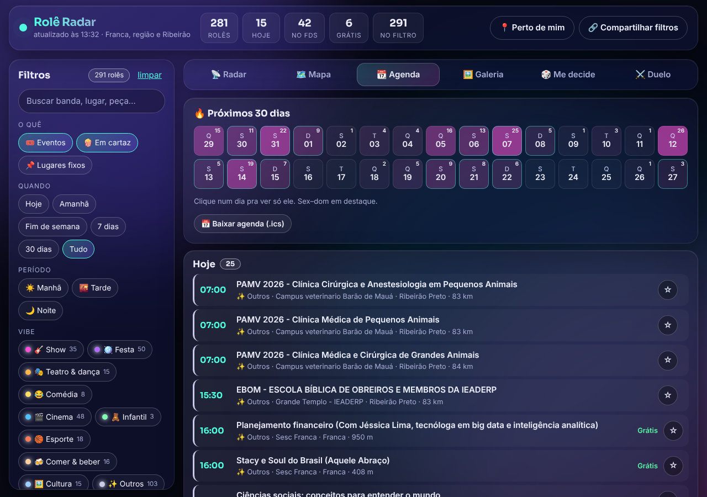
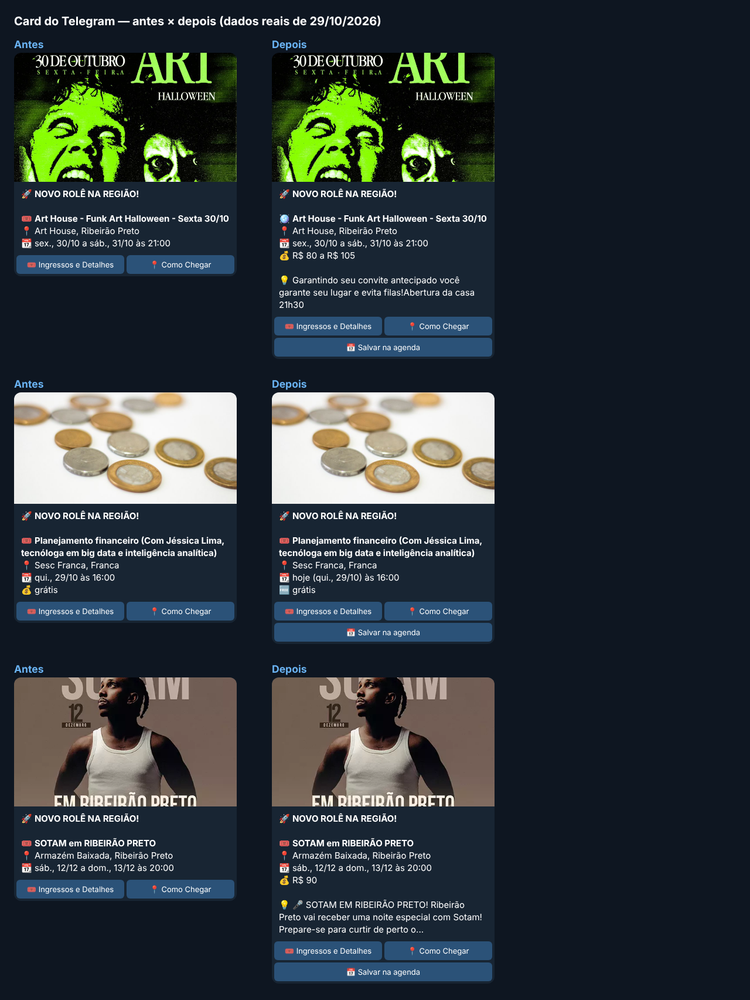
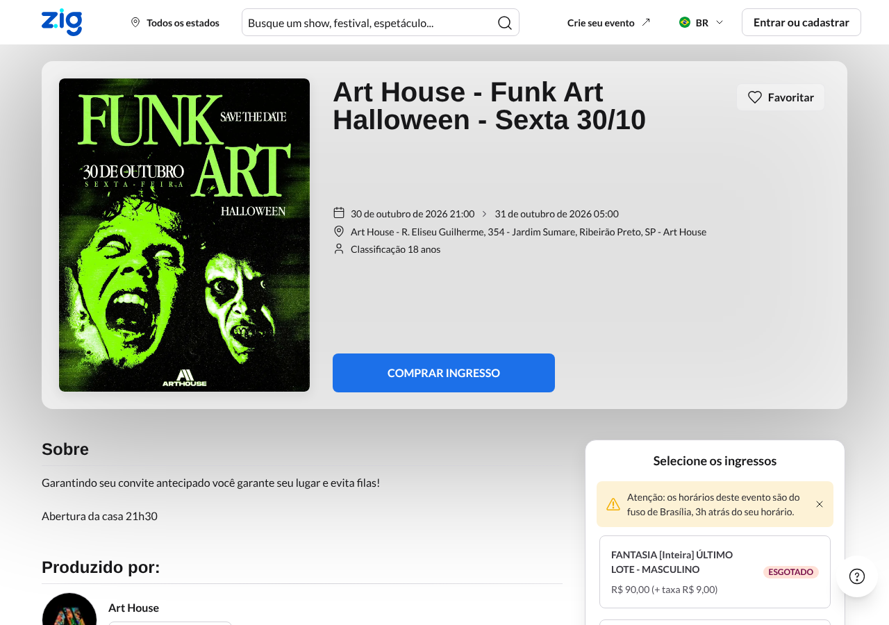
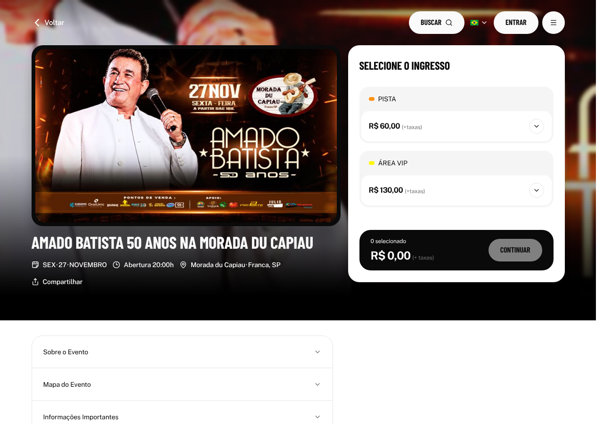
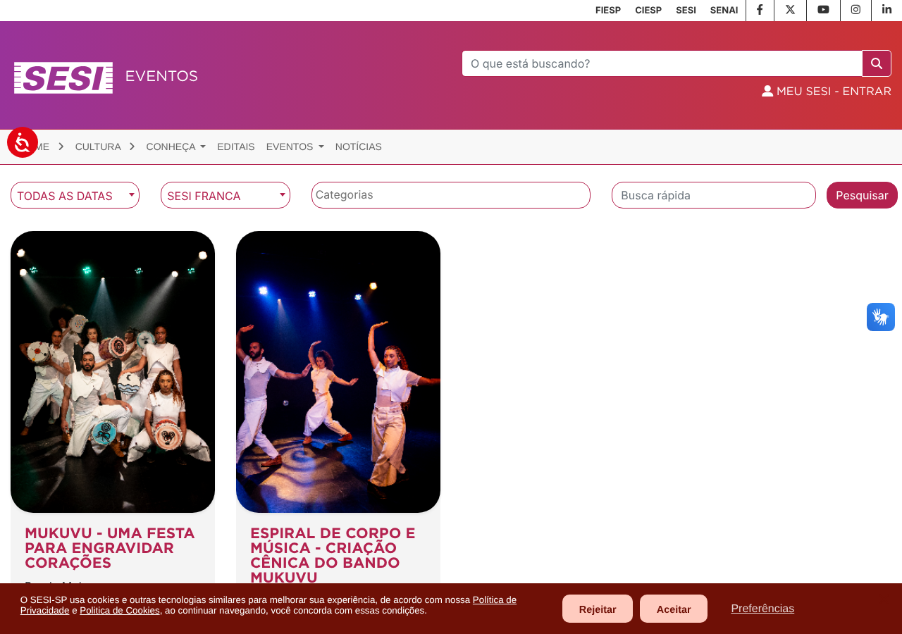
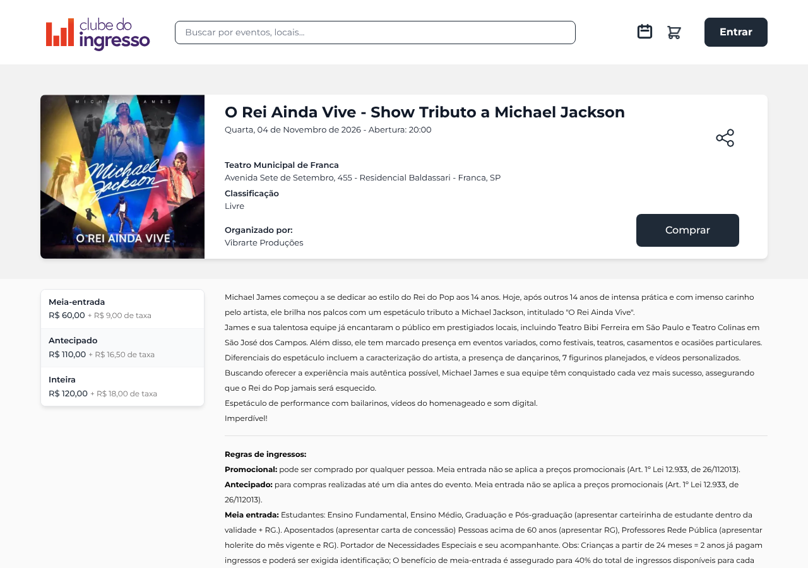
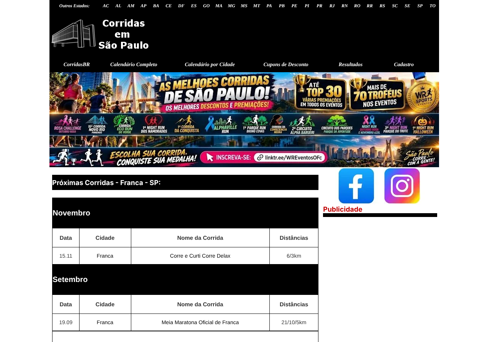
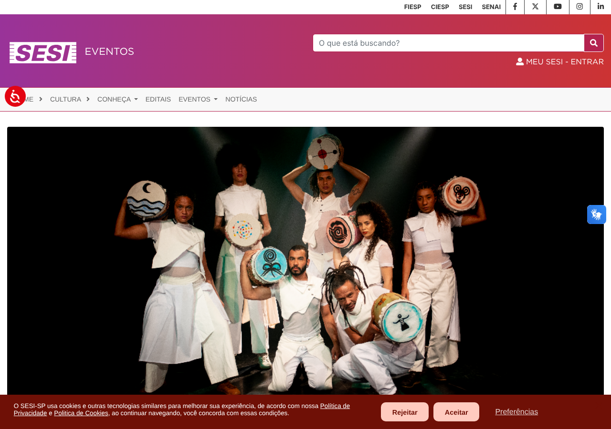
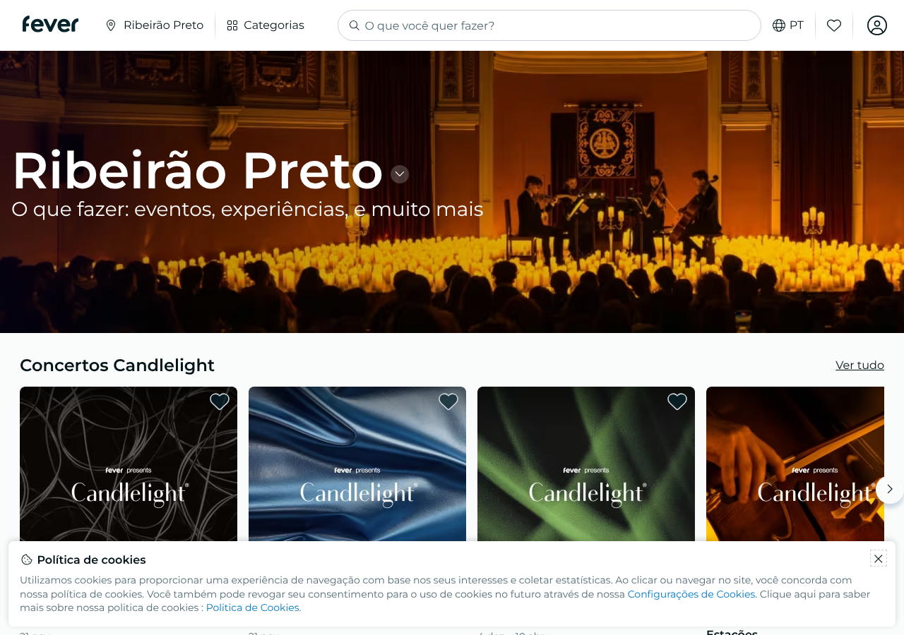

# Rodada de pesquisa — 2026-10-29

Varredura de fontes novas, qualidade do parser, cards do Telegram e SQLite.
Medições feitas rodando o `digest` real (sem Telegram/IA) num banco limpo:
**281 eventos**. Prints em [`docs/prints/`](prints/).

## 1. Qualidade dos dados (antes desta rodada)

| Campo vazio | Eventos | % |
|---|---|---|
| preço | 236 | 84% |
| descrição | 196 | 70% |
| horário | 163 | 58% |
| local | 42 | 15% |
| imagem | 7 | 2% |

Por fonte: **Q2** (25), **OTicket** (28), **Evento ON** (23), **Guichê Web** (12)
e **Duoticket** (40) vinham sem preço *e* sem horário. **Sympla** (76) sem preço.

O print mostra também ruído: cursos e congressos do Sympla ("PAMV – Clínica
Cirúrgica…", "Escola Bíblica") somavam 17 de 281 eventos (6%), e 103 caíam em "Outros".

## 2. Implementado nesta rodada

| Mudança | Efeito medido |
|---|---|
| **Q2: detalhe por slug** (`cdn…/getEventTicketsBySlug/{slug}.json`, achado no XHR da página) | horário e preço de **0/25 → 25/25**; vídeo do YouTube vira trailer; estoque zerado vira "esgotado" |
| **schema.org/Event na página do evento** (mesma requisição da og:image) | Zig, Articket e Guichê Web passam a ter faixa de preço ("R$ 50 a R$ 300"), horário e status (esgotado/cancelado/adiado) |
| **Card do Telegram**: emoji por categoria, "hoje/amanhã/em N dias", 🆓, linha de status, botão **📅 Salvar na agenda** (Google Agenda) | a citação `> 💡` saía **literal**: Markdown legado não tem blockquote |
| **Parser de data** (`parseDataBr`) | lê "às 20h", "22H", "18 horas", "12.11.2026"; "15 de novembro de 2027" deixava de virar 2026 |
| **Festa que vira a madrugada** (Zig, Sympla, Articket) | "sex. 30/10 a sáb. 31/10" para uma festa das 21h às 5h passa a ser evento de um dia |
| **SQLite** | `busy_timeout` + `synchronous=NORMAL` (dashboard e CronJob dividem o arquivo); coluna `status`; `items` já processados saem após 60 dias (a tabela só crescia); poda de curso/congresso/visita técnica |

## 3. Fontes novas recomendadas (ainda não integradas)

Por ordem de valor. Eventos contados em 2026-10-29.

| # | Fonte | Endpoint | Formato | Eventos agora | Observação |
|---|---|---|---|---|---|
| 1 | **SESI-SP Cultura** (teatros SESI) | `sesisp.org.br/eventos?data=0&codigoUnidade={uuid}` → detalhe `/evento/{uuid}/{slug}` | HTML | Franca 2, RP 10, Barretos 6, Sertãozinho 2 | UUIDs: Franca `bf3fb13b-884c-41f2-8f6a-151b18abb86b`, RP `1d2a9687-9384-41c5-9e4b-cf87cb38236e`, Barretos `a73243c6-63ed-4be1-a64b-b72f28dd7f28`, Sertãozinho `581f64d6-74ca-4795-9b2e-9ad6b9a8b31f`. Gratuito com reserva. O detalhe lista sessões de outras cidades: filtrar pela unidade. Não é o site de notícias já descartado. |
| 2 | **Clube do Ingresso** | home `clubedoingresso.com/` (~731 cards) → `/evento/{slug}` com JSON-LD | HTML + JSON-LD | Franca 1 (Tributo a Michael Jackson, Teatro Municipal, 04/11, R$ 60–120), RP 2 | Estava como "sem eventos da região" no `bilheterias.md`. O card não diz a cidade: confirmar no detalhe. |
| 3 | **CorridasBR** | `corridasbr.com.br/sp/calendario.asp` (estado todo) ou `/sp/por_cidade.asp?cidade=Franca` | HTML latin-1 | 13 provas na região em novembro (Franca 15/11) | data `dd.mm` sem ano (usar `parseDataBr`), sem preço/imagem. |
| 4 | **Revide – Agenda Cultural** | `revide.com.br/agenda-cultural/?mes=11&ano=2026` | HTML limpo | ~50 em outubro (RP) | só Ribeirão; sem feed. |
| 5 | **Fever / Candlelight** | `feverup.com/pt/ribeirao-preto`, JSON em `<script id="serverapp-state">` | JSON embutido | 7 concertos (RP) | preço em `price_info.amount`; ignorar "Cartão-presente"; datas com `+00:00` que parecem hora local. |
| 6 | **Ingresso.com – sessões** (ampliação) | `api-content.ingresso.com/v0/sessions/city/{cid}/theater/{tid}` | JSON | Moviecom Franca (581); RP: Cinemark 346, Cinépolis 1127/853, UCI 621; Barretos Centerplex 1214 | horário, sala, dublado/legendado e **preço** — hoje o card de cinema não tem horário. |
| 7 | **Prefeitura de Barretos – API** | `public.barretos.sp.gov.br/api/v1/noticias?pagina=1&limite=20` | JSON | ~4 de 20 culturais | é notícia: entra como feed pro `extractEvents()`. |
| 8 | **Sympla Uberaba** | `/eventos/uberaba-mg` | RSC (já suportado) | 24 | só configuração; ~140 km. As cidades pequenas de MG devolvem eventos de Franca/Passos. |

Menor valor: RSS da **Tribuna de Ituverava** (`tribunadeituverava.com.br/rss.xml`)
e **Senac** (`eventos.sp.senac.br/unidades/senac-franca/`, mais educativo que lazer).
Vale uma lista fixa dos grandes eventos anuais: Agrishow (26–30/04/2027),
Ribeirão Rodeo Music (30/04–08/05/2027), Fenasucro (10–13/08/2027), Festa do Peão de Barretos (agosto).

| SESI Cultura Franca | Clube do Ingresso (Franca) | CorridasBR (Franca) |
|---|---|---|
|  |  |  |
|  |  |  |

## 4. Fontes integradas com problema

| Fonte | Situação em 2026-10-29 |
|---|---|
| **Ticket360** | `/eventos/pesquisar?s=` responde **404** para todas as cidades: a rota mudou. Hoje é requisição jogada fora a cada rodada. |
| **Mega Bilheteria**, **Franca Shopping** | 403 a partir de IP de datacenter (WAF). Conferir se em produção também. |
| **Prefeitura (turismo)** | parser ok; a agenda oficial não tem nada depois de 15/09/2026. |

## 5. Próximas oportunidades (não feitas)

**Parser**
- Faixa "de 25 a 27 de dezembro" / "04 até 30/07" vira só o último dia; dá para devolver `date` e `end_date`. Hoje só afeta fontes sem eventos na região.
- `extract.ts` manda só os primeiros 900 caracteres da matéria: mandar trechos em volta das datas (`DATE_HINT`) pega a data que fica no fim do texto.
- O prompt de extração pode pedir `description` (1 frase) e `category`. Notícia vira card sem 💡.
- OTicket, Evento ON, Duoticket e Sympla não têm JSON-LD; preço só por XHR. Fazer o mesmo levantamento F12 que achou o endpoint da Q2.

**Telegram**
- Trocar Markdown legado por `parse_mode: HTML`: só `<>&` a escapar, e libera `<blockquote expandable>` para a descrição.
- 20 lançamentos + eventos do dia saem um por mensagem; o limite de grupo é ~20 msg/min. Um álbum por bloco de lançamentos reduz o 429.
- Distância/tempo de estrada nos eventos de fora (os centros das cidades já estão em `web/places.ts`).
- Previsão do tempo (Open-Meteo, sem chave) para evento ao ar livre do dia.

**SQLite**
- Coluna `source` e tabela `event_links(event_id, source, link, price)`: hoje o primeiro link vence para sempre e o dedupe não registra de onde veio.
- `last_seen_at`: evento que some da bilheteria (cancelado sem aviso) é detectável.
- `lat`/`lon` direto do Sympla (o payload traz), sem gastar cota do Nominatim.
- Dedupe só por título canônico + data: "Show Gusttavo Lima" × "Gusttavo Lima – Turnê" não fundem. Similaridade de tokens com mesmo dia + cidade resolveria.
